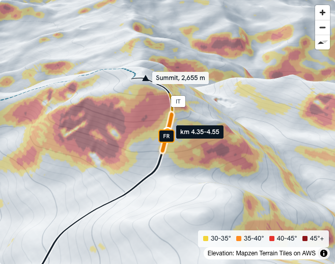
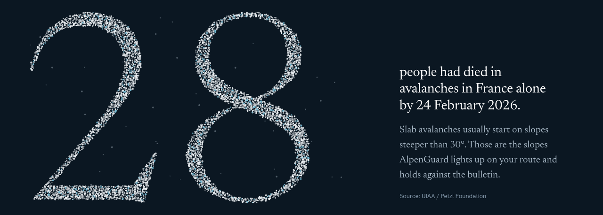

# AlpenGuard

**An avalanche safety assistant for ski touring.** The bulletin, the angle of every slope on your route and other climbers' reports, in any language, on one map. And if you don't check in by your return time, it sends your route to the people you chose.

**[Open the live demo →](https://alpenguard-theta.vercel.app)**

<p align="center">
  
</p>

A student prototype by Fanis Papaspyrou, Anastasis Skourtis, Ioannis Manis and Christos Gkotzamanis.

## What it does

<table>
  <tr>
    <td width="50%"></td>
    <td width="50%"></td>
  </tr>
  <tr>
    <td><b>Check a route.</b> Load the sample tour or your own GPX. Real terrain gives the slope every 25 m; plain rules flag the stretches that are 30° or steeper on an aspect and elevation the bulletin names, with the reports that back them up.</td>
    <td><b>Why it matters.</b> Today the bulletin, the route and the reports live in three apps and three languages. AlpenGuard joins them, and it never says a slope is safe.</td>
  </tr>
</table>

- **The AI reads, the rules decide.** A language model translates reports and reads your spoken plan; it never decides what gets flagged.
- **Every flag shows its source and age:** which bulletin, which report, in which language, how many hours old.
- **The overdue alert goes to your people, not to 112.** A server-side timer, so a flat battery or no signal doesn't stop it.
- **Your position is deleted when you check in.**

## Run it

```bash
npm install
npm run dev        # http://localhost:5173
npm test           # rules engine and terrain math
npm run build      # static site in dist/
```

## What is real and what is test data

| Part | In this demo |
|---|---|
| Terrain, slope, aspect | **Real.** Computed in the browser (Web Worker) from AWS Terrarium elevation tiles, using Horn's method every 25 m along the route. |
| Sample route | **Real terrain**, Beaufortain (French Alps), 4.9 km, 1,498 → 2,655 m. Generated from the elevation model by `scripts/` (`npm run data`). |
| Slope-angle map layer | **Real.** A MapLibre custom protocol computes 30–35 / 35–40 / 40–45 / 45°+ bands from the same tiles. |
| Avalanche bulletin | Test data in the EAWS CAAML v6 JSON shape (`src/data/bulletin.caaml.json`). |
| Climber reports | Test data shaped like Camptocamp API outings, in FR / DE / IT (`src/data/reports.json`). |
| AI (translation, plan parsing) | Cached model output (`src/data/ai-cache.json`). Unknown plans go through an offline fallback parser. No API key is needed. |
| Rules engine | **Real**, in `src/lib/rules.ts`. A stretch is flagged when it is ≥30°, on an aspect and at an elevation the bulletin names. Reports within 500 m and under 48 h strengthen a flag. |
| Overdue timer and dossier | Simulated clock. Nothing is sent. |
| Voice plan | The browser's speech recognition where it works (Chrome, Edge, Safari). In Brave, Firefox, or when the service fails, it records and transcribes on the device with Whisper base (transformers.js, ~80 MB downloaded once). Audio never leaves the device. |

## Stack

Vite, React, TypeScript, MapLibre GL JS (3D terrain, light hillshade, slope tiles computed in a worker pool), maplibre-contour, fast-png, @huggingface/transformers (on-device speech), @tmcw/togeojson, GSAP, Lenis, Vitest. Type: Newsreader and Hanken Grotesk.

## Credits

Photographs (Wikimedia Commons / Flickr, CC BY and CC BY-SA) are listed in `src/data/credits.json` and credited in the page footer. Elevation: Mapzen Terrain Tiles on AWS.
